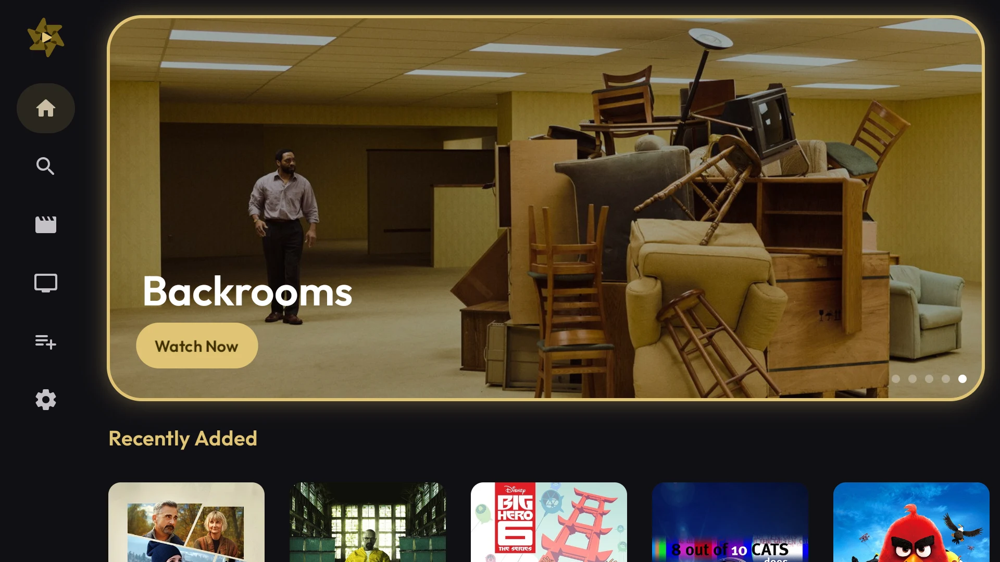
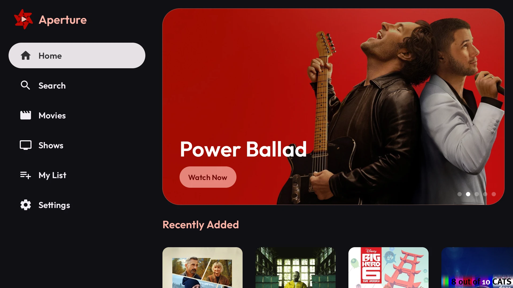
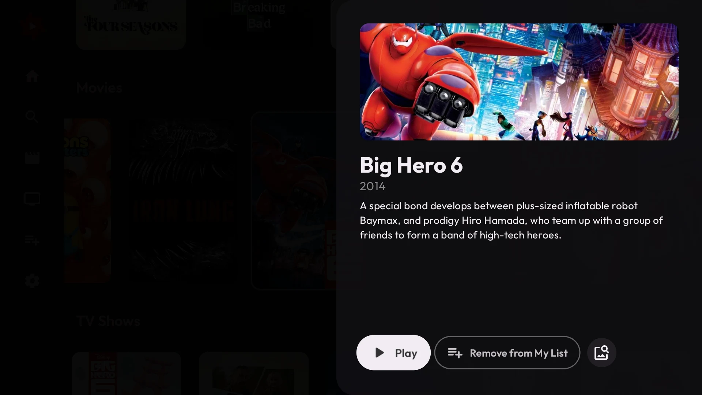
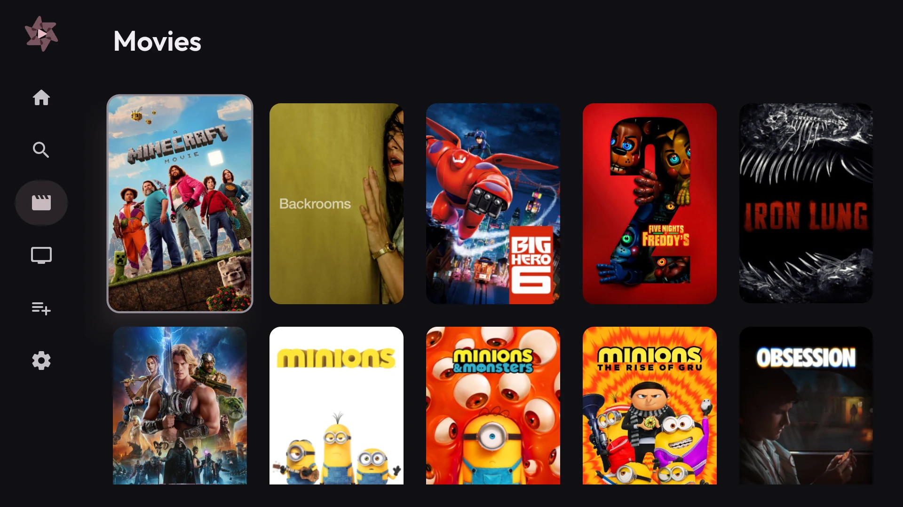
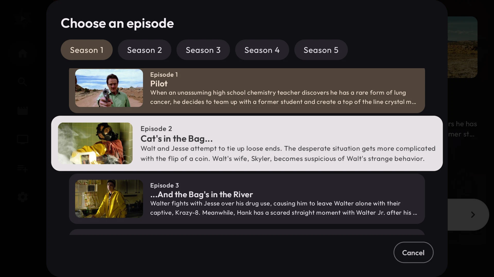
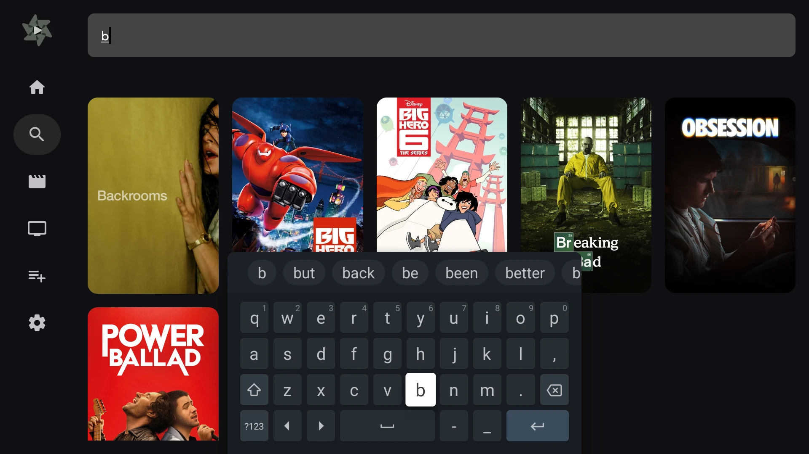
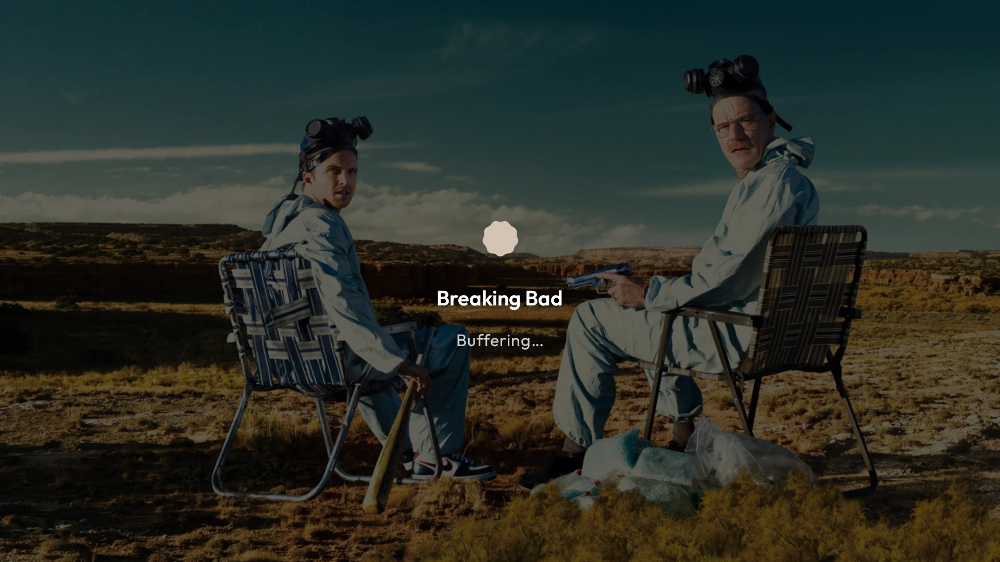
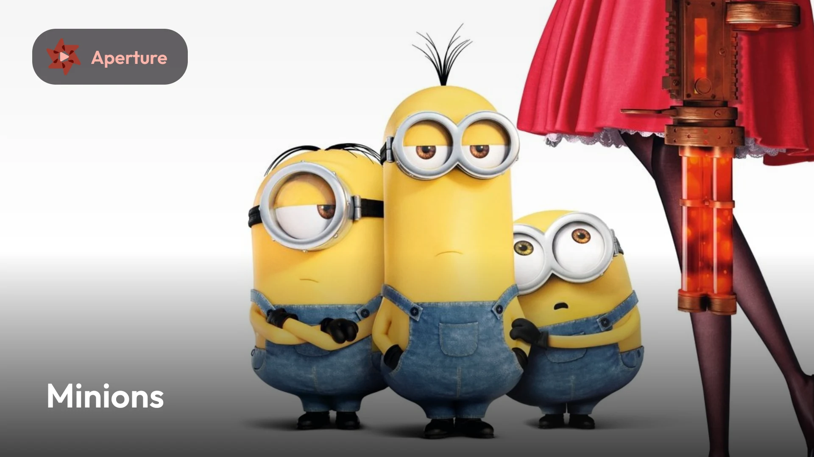
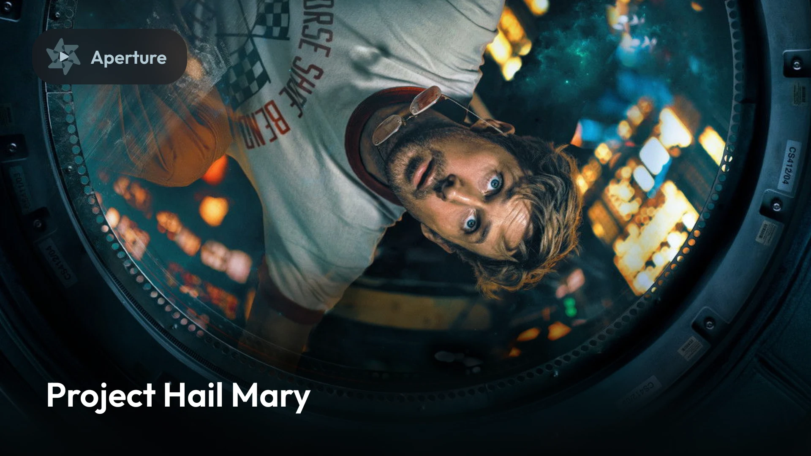

<p align="center">
  
</p>

<h1 align="center">Aperture</h1>

<p align="center">
  <i>Finally, a Material 3 media player for Android TV!</i>
</p>

<div align="center">

[](https://github.com/sponsors/XDanfr)
[](https://discord.gg/fuxMAVBccK)
[](https://github.com/XDanfr/Aperture/releases/latest)
<br>
[](https://xdan.cc/aperture)
[](https://instagram.com/axis.eco)

</div>

<p align="center">
  
</p>

<p align="center">
  Aperture turns the films and shows already on your TV, USB drive or computer into a library that looks like a streaming service.
  It finds artwork and details on TMDB, plays almost anything through Media3, and is built to be driven entirely with a remote.
</p>

<p align="center">
  <a href="#-whats-new-in-v05">What's new</a> ·
  <a href="#-features">Features</a> ·
  <a href="#-getting-started">Getting started</a> ·
  <a href="#-screenshots">Screenshots</a> ·
  <a href="#%EF%B8%8F-roadmap">Roadmap</a> ·
  <a href="#-faq">FAQ</a>
</p>

---

## 🆕 What's new in v0.5

v0.5 is the biggest Aperture update yet! The whole UI has been rebuilt on **Material 3 Expressive**.

* 🎨 **Material 3 Expressive redesign** using the official Expressive colour, shape and motion tokens, with a new launch animation and an animated sidebar, plus much more
* 📱 **Aperture Companion**: an Android phone app that browses your TV's library, starts playback and works as a remote
* 💬 **Full OpenSubtitles integration**: sign in, then search for and download subtitles without leaving the player
* ⏭️ **Next episode popup** with a countdown in the last 10 seconds of an episode
* 📺 **Grouped TV shows**: one poster per show, with a season and episode selector that continues where you left off
* 🧭 **New onboarding** that's comfortable with a remote, plus an optional **Learn Aperture** tour
* 🖥️ **Desktop builds** for Windows, macOS and Linux, from the same code as the TV app!

> [!IMPORTANT]
> **Coming from 0.4.2-alpha or earlier?** v0.5 is a new package (`cc.xdan.aperture`) with a new signing key, so your settings, My List and watch progress start fresh. Your media files aren't touched. See [Updating from 0.4.x](#updating-from-04x).

## ✨ Features

### 🎨 Interface and themes
* Material 3 Expressive throughout, designed for the remote first. Focus, Back and the sidebar always return you to where you were
* **Spotlight** on Home showcases your library, with the option to hide finished titles for a set number of days
* Ten themes: Aperture Purple, Material TV, Emerald, Cinema Red, Sunset Orange, Electric Blue, Ocean Teal and Neon Pink, plus **Artwork Dynamic** (preview), which takes its colours from the artwork on screen and **match phone**, which gives the TV the Material You colours of a paired phone
* **Ambient mode** for when the TV is idle: cinematic full-screen backdrops or a poster wall, with an optional clock

### 📚 Library
* Scans `Movies/` and `TV Shows/` folders on internal storage, plus `Download`, `DCIM` and `Videos`. Add more folders, such as USB drives, in Settings.
* Matches titles and finds posters, backdrops and synopses using **TMDB**. You can correct or add a match yourself in the app.
* Two TV show layouts: **Grouped shows** (one poster per show) or **Episode rows**. You can switch without rescanning.
* **Continue Watching** and **My List**, with shows opening on the current or next episode wherever you find them
* Search, hidden media, and library tools for rescanning or clearing the artwork cache

### ▶️ Playback
* Powered by **Media3 / ExoPlayer**, with an FFmpeg software-decoding fallback for formats your TV can't decode in hardware.
  * Desktop is powered by **MPV**
* Quick Menu for audio tracks, subtitles and aspect ratio (fit, crop or stretch).
* **Subtitles**: local and embedded tracks, OpenSubtitles search and download, timing sync, and customisable size and background.
* **Next episode popup** that plays the next episode automatically, or lets you dismiss it.
* Experimental tunnelling for 4K A/V sync on supported hardware.

### 📱 Aperture Companion (pre-alpha)
* Pair your phone with a QR code or a 6-digit code over your home network.
* Browse the TV's library, start something on the TV, and control playback from your phone.
* Follows the TV's theme, or uses Material You or any Aperture palette.
* Only metadata and remote control commands are sent between devices. Video never leaves the TV.

### 🖥️ Desktop
* Windows, macOS and Linux builds share the TV app's screens, themes and animations, with mpv for playback.
* Use the mouse or the keyboard: arrow keys and Enter work just like a remote.

## 🚀 Getting started

### 1. Install on Android TV

1. On your TV, install [Downloader by AFTVNews](https://play.google.com/store/apps/details?id=com.esaba.downloader) (Google Play) or from the [Amazon Appstore](https://www.amazon.com/dp/B01N0BP507/?tag=aftvn-20).
2. Download the latest `.apk` from [**Releases**](https://github.com/XDanfr/Aperture/releases/latest) and install it. Allow Downloader to install unknown apps if Android asks.
3. Open Aperture, allow access to your videos, and let the first scan finish. You can choose a theme and set up Ambient mode while you wait.
4. Choose **Get started**, or **Learn Aperture** for a short tour.

> [!NOTE]
> Aperture runs on Android TV and Google TV devices with Android 8.1 (API 27) or later.

### 2. Organise your media

Aperture works best with clean file names and a standard folder layout. Here's an example:

```text
Movies/
├── Big Hero 6 (2014).mkv
└── Project Hail Mary (2026).mp4
TV Shows/
└── Breaking Bad/
    ├── Season 01/
    │   ├── S01E01.mkv
    │   └── S01E02.mkv
    └── Season 02/
        └── S02E01.mkv
```

* Put `Movies/` and `TV Shows/` on internal storage or a USB drive. Files in `Download`, `DCIM` and `Videos` are found too.
* Using a USB drive or another location? Add it under **Settings → Library & storage → Media folders** on supported devices.
* Including the year helps Aperture choose the right TMDB match. Quality tags like `1080p` or `x265` are ignored, so no need to strip them.
* If something is matched incorrectly, open it and choose **Choose artwork and metadata** (picture search icon) to search TMDB again, where you can type the name of the title.

### 3. Pair the phone companion (optional)

1. Install the Aperture Companion APK from [Releases](https://github.com/XDanfr/Aperture/releases/latest) on an Android phone (Android 10 or later).
2. On the TV, open **Settings → Phone companion**. Aperture shows a QR code and a 6-digit code.
3. In the companion, scan the QR code, or pick your TV from the list and type the code.

Your phone and TV need to be on the same network. On Android 17, both devices will ask for local network access.

### 4. Turn on OpenSubtitles (optional)

Sign in to your [OpenSubtitles.com](https://www.opensubtitles.com) account under **Settings → Playback & subtitles**. You can then search for and download subtitles from the player's Quick Menu.

### Updating from 0.4.x

v0.5 uses a new signing key and the package name `cc.xdan.aperture`, so it installs alongside the old app rather than replacing it.

1. Install the new APK, then **open it**. Installing alone doesn't start the update.
2. Aperture detects the old app and walks you through uninstalling it. Choose **Uninstall** on Android's confirmation screen.
3. Your library is scanned again. Folders on removable storage need to be added again.

Settings, My List, watch progress and sign-ins aren't carried over. Your media files stay where they are.

### Desktop (Windows, macOS, Linux)

The Windows installers (MSI, EXE) and the macOS DMG include mpv. The Linux packages (deb, rpm, AUR, Flatpak) install mpv from your distribution or include it. When you first open Aperture, choose the folders that make up your library.

See [docs/DESKTOP.md](docs/DESKTOP.md) for controls, packaging and licensing.

### Build from source

1. Clone the repository:

   ```bash
   git clone https://github.com/XDanfr/Aperture.git
   ```

2. Open it in Android Studio with **JDK 17 or 21** (other versions are untested).
3. Copy `local.properties.example` to `local.properties` and add a `TMDB_API_KEY` and an `OPENSUBTITLES_API_KEY`.
4. Sync Gradle, then run `app` on an Android TV device or emulator with **API 27+**, or `mobile` on a phone with **API 29+**.
5. For desktop, install libmpv (`brew install mpv`, `apt install libmpv2`, …) and run:

   ```bash
   ./gradlew :desktop:run
   ```

> [!NOTE]
> `master` moves quickly and the latest commits may contain bugs. For a stable experience, use a build from [Releases](https://github.com/XDanfr/Aperture/releases/latest).

## 📸 Screenshots

<table>
  <tr>
    <td width="50%"></td>
    <td width="50%"></td>
  </tr>
  <tr>
    <td align="center"><sub><b>Home</b> with the sidebar open</sub></td>
    <td align="center"><sub><b>Details</b>, with playback and My List controls</sub></td>
  </tr>
  <tr>
    <td></td>
    <td></td>
  </tr>
  <tr>
    <td align="center"><sub><b>Movies</b>, A–Z</sub></td>
    <td align="center"><sub><b>Season and episode selector</b> for grouped shows</sub></td>
  </tr>
  <tr>
    <td></td>
    <td></td>
  </tr>
  <tr>
    <td align="center"><sub><b>Search</b></sub></td>
    <td align="center"><sub><b>Loading playback</b> with the title's artwork</sub></td>
  </tr>
  <tr>
    <td></td>
    <td></td>
  </tr>
  <tr>
    <td align="center" colspan="2"><sub><b>Artwork splash screens</b></sub></td>
  </tr>
</table>

## 🗺️ Roadmap

Aperture is in **ALPHA**. These are next:

### Tester feedback priorities
- [ ] **Large-library performance**: faster first entry and smoother scrolling on Movies with 900+ titles, by measuring database work, UI preparation and artwork loading before choosing a fix (paging, retained library data, bounded artwork caching).
- [ ] **Compact, adaptive sidebar**: a narrower expanded sidebar whose focus pill grows and shrinks with each destination, keeping the original branding and readable labels.

### Playback and TV interaction
- [ ] **Audio synchronisation**, forwards and backwards
- [ ] **Default audio track** selection in Settings
- [ ] **Animated idle Spotlight transitions**: a Google TV inspired wipe between banners, matching remote navigation
- [ ] **Experimental options section** for alternate Spotlight layouts, classic player controls, sidebar branding and similar options

### Further out
- [ ] **Resizable banners and title logos**, including white variants where appropriate
- [ ] **NAS, Jellyfin and Plex** libraries (see Jellyfin branch for progress)
- [ ] **3D TV** support (requested)

<details>
<summary><b>Completed in v0.5</b></summary>

- [X] Transition to Material 3 Expressive
- [X] Complete OpenSubtitles integration
- [X] Onboarding overhaul
- [X] Subtitle Quick Menu layout fixes
- [X] Desktop port (Windows, macOS, Linux)
- [X] Sidebar stays closed behind playback menus
- [X] Spotlight and library-wide show continuation
- [X] Next episode popup
- [X] Consistent Continue Watching progress colour
- [X] Animated sidebar focus and brand reveal
- [X] Simplified visible settings

</details>

## 🛠️ Tech stack

* **Language:** [Kotlin](https://kotlinlang.org/)
* **UI:** [Jetpack Compose for TV](https://developer.android.com/training/tv/playback/compose), shared with desktop through [Compose Multiplatform](https://www.jetbrains.com/compose-multiplatform/)
* **Media engine:** [Media3 / ExoPlayer](https://developer.android.com/media/media3) on Android, [mpv](https://mpv.io) on desktop
* **Theming:** Material 3 Expressive
* **Metadata:** [TMDB](https://www.themoviedb.org) and [OpenSubtitles](https://www.opensubtitles.com)
* **Website components:** [matraic/m3e](https://github.com/matraic/m3e)

## 🤝 Contributing

Contributions are what make the open-source community such an amazing place! Want a feature or a bugfix? Pull requests are super welcome, and so are issues.

* **Issues:** Open an issue if you find a bug or want to suggest a feature.
* **Pull requests:** Fork the project, create a branch and open a PR. Please follow the existing project style, and lean towards Material 3 Expressive as Aperture moves to that look.
* **Docs:** [Desktop](docs/DESKTOP.md) · [Phone companion](docs/development/phone-companion.md) · [Signed APK builds](docs/signed-apk-builds.md) · [Privacy](docs/PRIVACY.md)

## 💬 FAQ

**Q: How does Aperture find media on local drives?**

**A:** Aperture uses Android's standard media and Storage Access Framework APIs to read the storage on your TV and any drives attached to it.

**Q: Aperture can't find some of my files. What should I check?**

**A:** Make sure they're under `Movies/` or `TV Shows/` (or `Download`, `DCIM`, `Videos`), or add their folder in **Settings → Library & storage**. Then run **Force Rescan Local Files**.

**Q: Was any AI used for this?**

**A:** Gemini was used as a starter to build the baseline template. Some AI features (like autocomplete) were used to speed up development. However, all code is human-reviewed, manually structured, and the trickier bugs are tackled by hand! See [AI.md](/AI.md) for more.

---

## 💜 Sponsors

Aperture wouldn't have active development without sponsors. Special thanks to them for keeping the app running :)

<div align="center">

[](https://github.com/sponsors/XDanfr)

</div>

<p align="center"><sub>If you like Aperture, please consider <a href="https://github.com/sponsors/XDanfr">supporting its development on GitHub Sponsors</a> 💜</sub></p>
